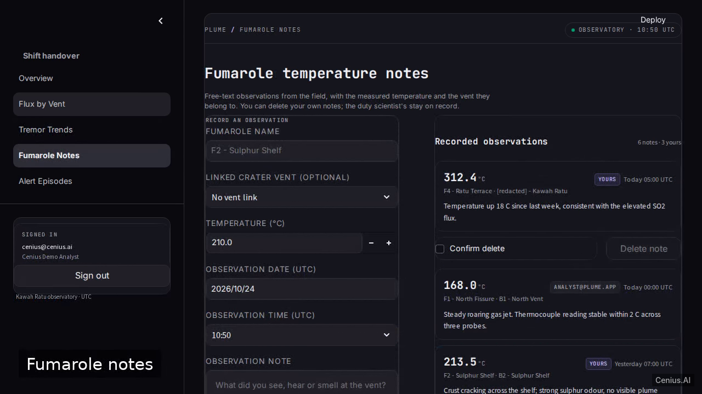
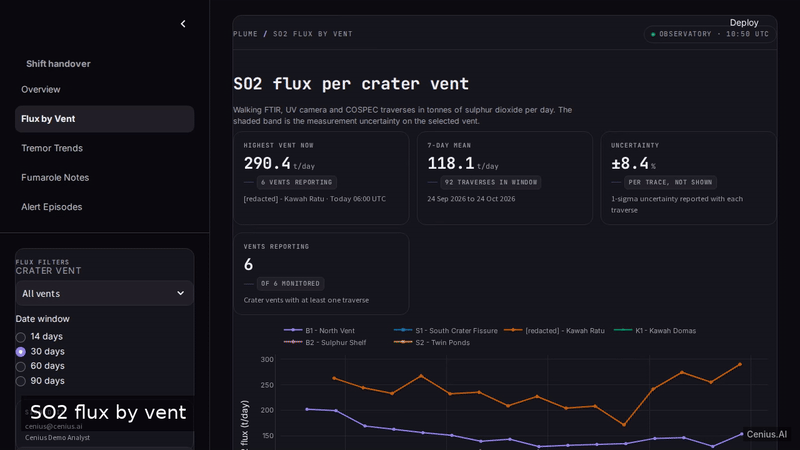
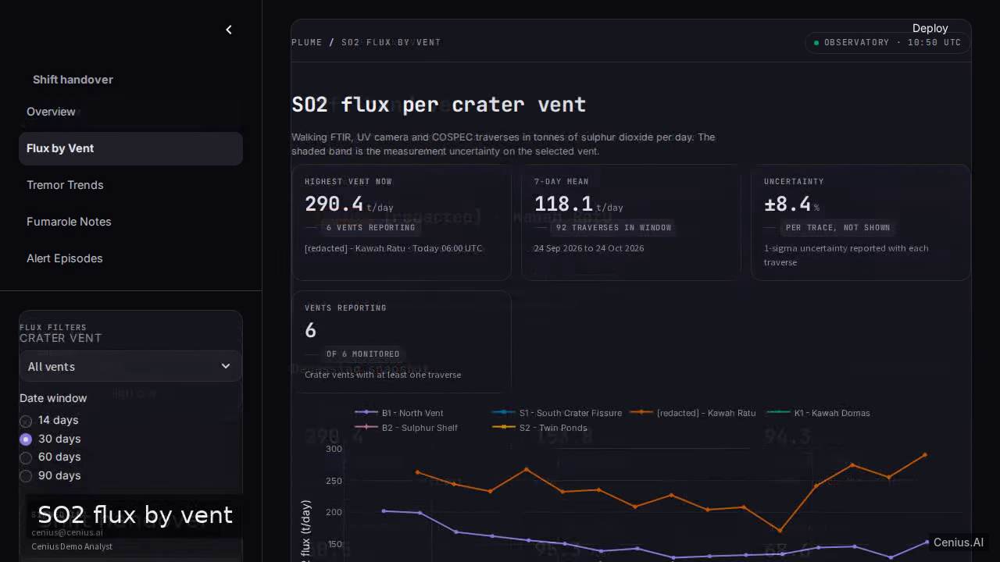
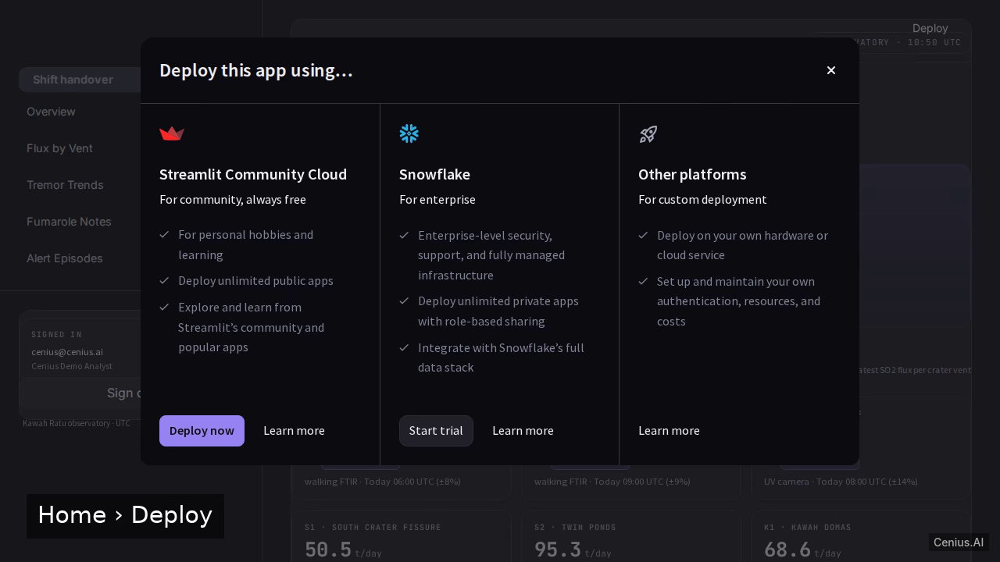

# Volcanic Gas Plume Explorer — complete Full-stack app monitoring dashboard example app

Most open-source monitoring dashboard projects ship a skeleton. **Volcanic Gas Plume Explorer** ships the whole thing: production-ready Full-stack app source, seeded demo data, and a Volcanic Gas Plume Explorer install script that runs in minutes. Volcanic Gas Plume Explorer is a Streamlit multi-page data app that lives entirely inside a nested plume/ folder (plume/streamlit_app.py as the entry, plume/pages/ for the feature pages, plume/requirements.txt plus se…. Apache-2.0-licensed — [remix Volcanic Gas Plume Explorer on cenius.ai](https://cenius.ai/marketplace/p/volcanic-gas-plume-explorer?ref=gh&utm_campaign=volcanic-gas-plume-explorer-webapp) for your own branded build.


[](LICENSE)  [](https://cenius.ai)

[](https://cenius.ai/marketplace/p/volcanic-gas-plume-explorer?ref=gh&utm_campaign=volcanic-gas-plume-explorer-webapp)

> **▶ [Open & edit in cenius.ai](https://cenius.ai/marketplace/p/volcanic-gas-plume-explorer?ref=gh&utm_campaign=volcanic-gas-plume-explorer-webapp)** — one click to an editable workspace: describe changes in plain English, get an instant preview, one-click deploy and host. Modifications made on the platform come with full rebrand & relicense rights.

_Local clone? See [Quick start](#quick-start) below. cenius.ai is the zero-setup path._

## Demo





▶ **[Full demo walkthrough](https://cenius.ai/marketplace/p/volcanic-gas-plume-explorer?ref=gh&utm_campaign=volcanic-gas-plume-explorer-webapp)** — watch it on the project page · [download MP4](.github/media/demo.mp4)

## Screenshots

  

## Architecture

No external services required: the entire monitoring dashboard runs from this Full-stack app repo (47 files). Top-level layout: `plume/`.

## Features

- SO2 flux per crater vent
- Tremor amplitude trend charts
- Fumarole temperature notes
- Eruption alert episode list with level filter
- Sign-in gate with demo credential

## Quick start

See [`USAGE.md`](USAGE.md) for full setup and usage instructions.

## Usage guide

### Overview

This is **Volcanic Gas Plume Explorer** — an importable library / package. This document covers the surface area you can use, with copy-pasteable examples for each entry point. For setup, see `INSTALL.md`.

### Quickstart

```python
## After `pip install this-package`:
import this_package

## Inspect the public API:
print(dir(this_package))
```

### Public API

_No public symbols were auto-extracted; see the source directly._

#### Import examples

```python
## After `pip install this-package`:
import this_package

## Inspect the public API:
print(dir(this_package))
```

### Worked example

1. Install: `pip install this-package` (Python) / `npm install this-package` (Node) — see the Import examples section above for the right command for your language.
2. Import + call the public surface in your own code.
3. Run your test suite to verify the integration before shipping.

### Reference

#### Entry points

_No explicit entry points declared in this project's manifests._

### Next steps

- Read [INSTALL.md](./INSTALL.md) if anything in the Quickstart didn't work.
- Inspect `.env.example` for the full list of environment variables this project understands.
- See [README.md](./README.md) for the architecture diagram + feature list.

_Full guide: [`USAGE.md`](USAGE.md)_

## FAQ

### What's the quickest way to self-host Volcanic Gas Plume Explorer?

Pull the repo, run `./install.sh`, and you are up — the script installs packages and pre-seeds the database. [`INSTALL.md`](INSTALL.md) covers any platform-specific tweaks.

### What powers Volcanic Gas Plume Explorer under the hood?

Powered by Full-stack app. This repo is the real thing — full source, seed data, and all — ready to clone and start up. Highlights include sign-in gate with demo credential.

### Is it possible to white-label Volcanic Gas Plume Explorer for a client?

Absolutely. [Open it on cenius.ai](https://cenius.ai/marketplace/p/volcanic-gas-plume-explorer?ref=gh&utm_campaign=volcanic-gas-plume-explorer-webapp) and remix it there — platform modifications come with full rebrand and relicense rights over your derivative, so the result is entirely yours.

### Does the Volcanic Gas Plume Explorer license allow commercial use?

Yes. The code is Apache-2.0-licensed — use it, modify it, and ship it commercially. See [LICENSE](LICENSE).

### Is there a no-code way to modify Volcanic Gas Plume Explorer?

Describe what you want changed on [cenius.ai](https://cenius.ai/marketplace/p/volcanic-gas-plume-explorer?ref=gh&utm_campaign=volcanic-gas-plume-explorer-webapp) — no code editing needed; the platform produces a fresh build you can download and deploy.

## License & rebranding

Released under the [Apache License 2.0](LICENSE) (© 2026 Cenius AI) — free for personal and commercial use. The Cenius name/logo are trademarks (see NOTICE).

**Need a customized version?** [Remix this app on cenius.ai](https://cenius.ai/marketplace/p/volcanic-gas-plume-explorer?ref=gh&utm_campaign=volcanic-gas-plume-explorer-webapp) — modifications made on the platform come with **full rebrand & relicense rights** over your derivative.

## Built with cenius.ai

This entire application — code, design, seeded demo data — was generated on **[cenius.ai](https://cenius.ai)** from a plain-English description.

- 🚀 [Build your own app on cenius.ai](https://cenius.ai)
- 🎛️ [Remix Volcanic Gas Plume Explorer on the marketplace](https://cenius.ai/marketplace/p/volcanic-gas-plume-explorer?ref=gh&utm_campaign=volcanic-gas-plume-explorer-webapp) — open it in a workspace, prompt for changes, and ship your own version.

More open-source apps: [the Cenius-ai catalog](https://github.com/Cenius-ai) · [showcase index](https://github.com/Cenius-ai/showcase)
